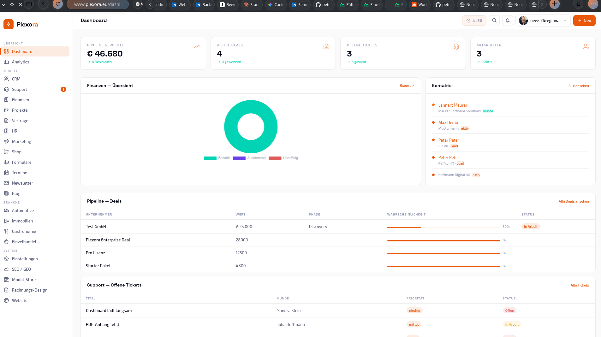
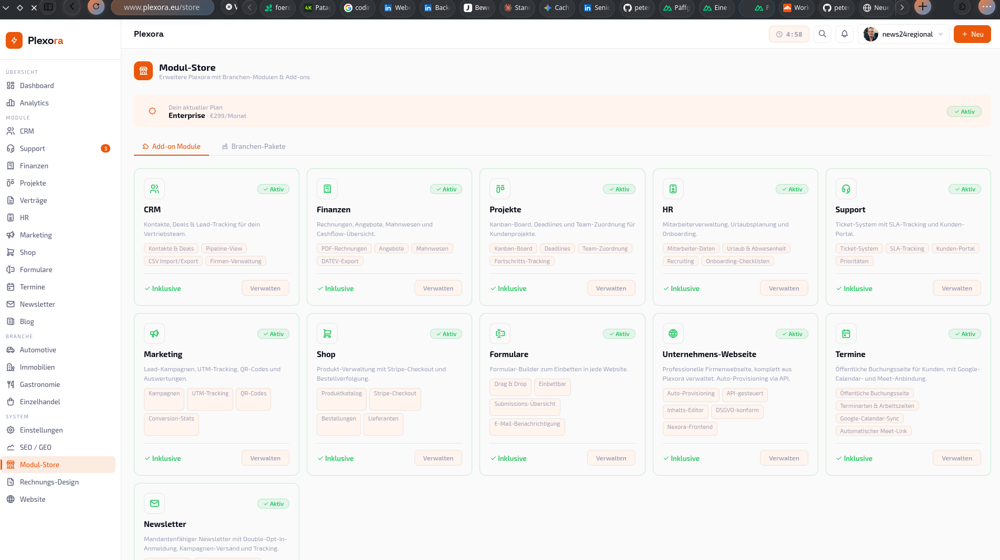
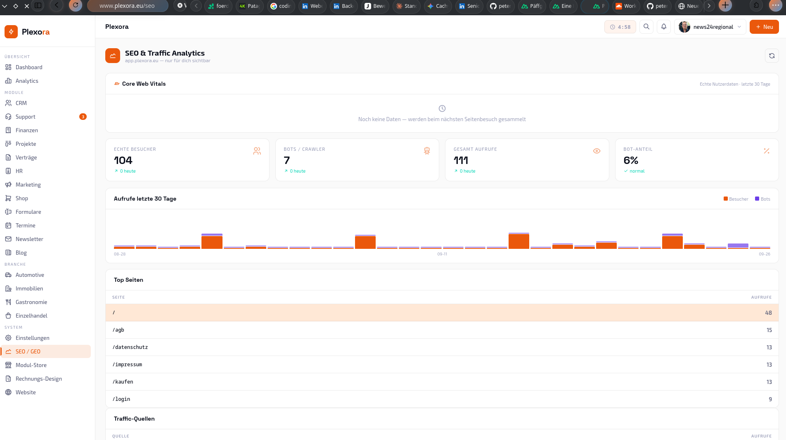

<div align="center">

# Plexora

**Eine Lizenz. Alles drin.**

Modulare All-in-One-Business-Plattform für kleine und mittlere Unternehmen:
CRM, Projekte, Finanzen mit E-Rechnung, HR, Support und mehr in einer Oberfläche.

[**Live ansehen → plexora.eu**](https://www.plexora.eu) · Demo-Zugang direkt auf der Startseite (Sandkasten, ohne Registrierung)

</div>

---

## Screenshots


*Dashboard mit Kennzahlen, Verlaufslinien und klickbaren Listen*


*Modul-Store: Module und Branchen-Pakete einzeln dazubuchen*


*Besucherstatistik und SEO-Auswertung*

---

## Was Plexora kann

| Bereich | Inhalt |
|---------|--------|
| **Basis-Module (15)** | Dashboard, CRM, Projekte, Finanzen, HR, Support, Verträge, Termine, Newsletter, Analytics, Team u. a. |
| **E-Rechnung** | XRechnung 3.0 und ZUGFeRD (EN 16931, PDF/A-3b), Eingangsrechnungen einlesen; geprüft mit KoSIT-Validator und Mustang/veraPDF |
| **Branchen-Pakete** | Gastro, Handwerk, Immobilien, Automotive, Fewo sowie ein Baukasten (Fitness, Bildung, Events, Reinigung, Vereine, Taxi) |
| **Website-Engine** | Eigene Seiten, Blog mit Kommentaren, Lead-Seiten, Formulare, Funnels |
| **Plugins und Store** | Module einzeln buchbar, eigene Module nach Anleitung ([docs/modul-schreiben.md](docs/modul-schreiben.md)) |
| **Mandanten und Rollen** | Mehrere Firmen getrennt, Rollen je Bereich, Team-Verwaltung |
| **Hilfe** | In-App-Hilfe mit Suche, Tooltips und Einführungstour |
| **PSC Manager** | Sicherheits-Center für den Betreiber: Systemmonitor, Datenintegrität, Sicherung und Notfallplan |
| **Demo-Sandkasten** | Besucher probieren alles aus, ändern dürfen sie nur in einer Erlaubnisliste; Zurücksetzen auf den Standard |

---

## Architektur

```
Browser ──► Cloudflare Pages (Nuxt 4, Vue 3, TypeScript)
               │
               ▼
        API Gateway ──► AWS Lambda (Nuxt/Nitro, plexora-api)
                              │
              ┌───────────────┼────────────────┐
              ▼               ▼                ▼
          DynamoDB          Cognito            S3
      (eine Tabelle     (Anmeldung,       (Dateien,
       je Funktion)      E-Mail-Alias)     Sicherungen)
```

| Bereich | Technologie |
|---------|-------------|
| **Frontend** | Nuxt 4, Vue 3, TypeScript, Pinia, Chart.js |
| **Backend** | Nitro-Serverrouten auf AWS Lambda hinter API Gateway |
| **Daten** | DynamoDB (je Funktion eine Tabelle), S3 |
| **Anmeldung** | AWS Cognito, rollenbasierte Zugriffsregeln |
| **Betrieb** | Cloudflare Pages (Push auf `main` baut neu), Lambda-Versionen mit Rückweg-Skript, CloudWatch-Monitoring, Kostenbremse |
| **Bot-Schutz** | Cloudflare Turnstile an öffentlichen Formularen |

---

## Qualität und Sicherheit

- **Über 1.300 automatische Tests** (Vitest): Rechnungsformate, Rollen, Mandantentrennung, Demo-Sandkasten, Bot-Schutz, Speicher und mehr.
- **Richtlinien als Code, vom Test erzwungen:** öffentliche Routen, Modulzugriff, Rollen und Sicherungsklassen jeder Tabelle sind in Tabellen festgehalten. Eine neue Route oder Tabelle ohne Eintrag lässt den Test scheitern.
- **Deploy mit Sicherungsnetz:** Tests und Build vorab, danach Prüfläufe gegen das Live-System, jederzeit zurückrollbar.
- **Keine Geheimnisse im Repository.** Schlüssel liegen in der Laufzeitumgebung.
- Dokumentation: [Sicherheit](docs/security), [AWS](docs/aws), [E-Rechnung](docs/e-rechnung.md), [Demo-Sandkasten](docs/demo-sandkasten.md), [Branchen-Baukasten](docs/branchen-baukasten.md), [Hilfe-System](docs/hilfe-system.md).

---

## Lokal starten

```bash
npm install
npm run dev        # http://localhost:3001
npm test           # alle Tests
npm run build      # Produktionsbuild
```

Die Umgebungsvariablen (AWS-Region, Cognito, Tabellen, Schlüssel) werden in der Laufzeitumgebung gesetzt und gehören nicht ins Repository.

---

## Status

🟢 **In aktiver Entwicklung und live im Einsatz**

- [x] Dashboard, CRM, Projekte, Finanzen, HR, Support, Verträge, Termine
- [x] E-Rechnung (XRechnung 3.0, ZUGFeRD) mit Eingangsrechnungen
- [x] Branchen-Pakete und Baukasten
- [x] Website-Engine mit Blog, Lead-Seiten und Bot-Schutz
- [x] Modul-Store und Plugins
- [x] Mandanten, Rollen, Team
- [x] In-App-Hilfe und Einführung
- [x] Demo-Sandkasten mit Zugangs-Pool
- [x] PSC Manager (Systemmonitor, Datenintegrität, Notfallplan)
- [ ] Gesamtsicherung und Ausweichsystem (PostgreSQL/MySQL) in Planung
- [ ] Englische Hilfetexte
- [ ] Mobile App
- [ ] Öffentliche API für Drittanbieter

---

## Autor

**Peter Päffgen**: [paeffgen-it.de](https://paeffgen-it.de) · [GitHub](https://github.com/peter1965p)
